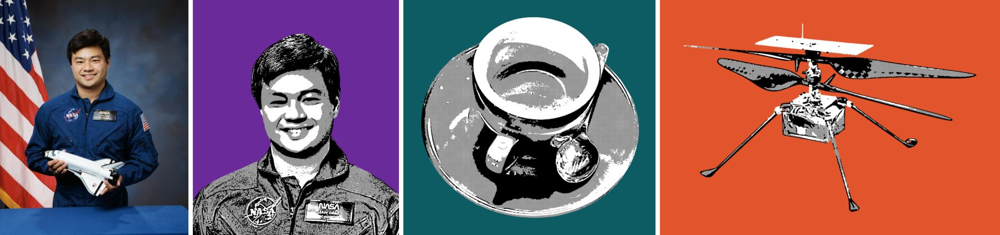
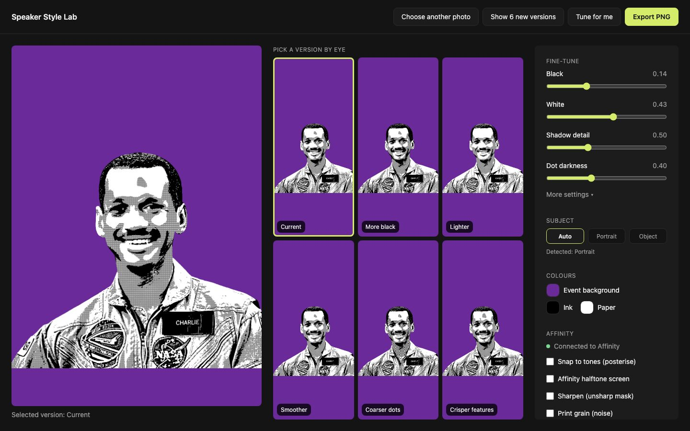

# speakerstyle

Turn a speaker's photo, or a photo of any object, into one consistent poster style: a clean cut-out in solid black, one grey made of halftone dots, and white. Put it on any background colour.



Photos taken in different light, with different cameras and backgrounds, come out as one consistent set. Faces stay recognisable and flattering, and the dots are the same size on every speaker. Start with clear, sharp photos.

## Start here

You need [uv](https://docs.astral.sh/uv/getting-started/installation/) (it brings its own Python 3.10–3.13), about 3 GB of disk space, and internet for the first run. macOS, Linux and Windows.

```bash
git clone https://github.com/Nikospy/speakerstyle.git && cd speakerstyle
uv run speakerstyle lab          # the lab: a local page at http://localhost:8770/
```

The first start takes a minute while uv installs the dependencies. The first portrait and the first object you process each take a few minutes more: they download their cut-out model (BiRefNet, about 1 GB each, once, into `models/`). After that a photo takes about 10 seconds. Everything runs locally on the CPU.

**With an AI coding agent** (Claude Code, Codex and others): open it in the project folder and say *"Read AGENTS.md and help me get started."* It checks your setup, runs a test photo and walks you through the lab.

## Make your first image



1. **Drag a photo** from a folder onto the page, or click **Choose photo**. Preparing it takes about 10 seconds (a few minutes for the very first photo, see above). The lab removes the background once, and every change after that shows in under a second.
2. **Pick a version by eye.** Click the one of the six versions next to the preview that is closest to what you want. To see six variations of your choice, click **Show 6 new versions**.
3. **Fine-tune with the sliders.** Each change shows right away.
4. **Set the colours.** **Event background** is the colour the image will sit on. **Ink** and **Paper** replace black and white, for example navy instead of black.
5. **Export.**
   - **Export PNG**: the cut-out with a transparent background, for your own layouts.
   - **Export JPG on background**: ready to post.
   - **Save settings**: saves the look, not an image, so you can apply it to other photos. See [Style a whole line-up](#style-a-whole-line-up).

### What the sliders do

| Slider | Move it right to… |
|---|---|
| **Black** | add more solid black (shadows, hair, clothes) |
| **White** | add more pure white (highlights, the lit side of the face) |
| **Shadow detail** | bring hair strands and features out of dark areas |
| **Dot darkness** | make the grey dots bigger, so the grey looks darker |

For finer control of dots, outlines and texture, open **More settings**. It has 10 more sliders: **Dot size**, **Screen angle**, **Smooth shapes**, **Feature lines** (eyes, lips, nostrils), **Hair and fabric lines**, **Smooth skin** (portraits only), **Local contrast**, **Clean up specks**, **Outline** (a thin black rim around the cut-out) and **Brush strokes**.

### Brush strokes

Portraits use brush strokes by default: hair, beards and fabric turn into streaks, as with a painting filter, instead of smooth patches, and thin lines trace glasses, ears and folds over the whole person, with an outline and lighter dots. Objects use smooth shapes, because brush strokes turn most objects too dark. To switch, pick the **Brush strokes** or **No brush strokes** version in the lab, or set **Brush strokes** to 1 or 0 under **More settings**. On the command line: `--params '{"paint":0,"grey":0.4,"outline":0}'` turns them off for a portrait, `--params '{"paint":1,"grey":0.3,"outline":1}'` turns them on for an object. With brush strokes on, **Shadow detail** lightens dark areas, **Smooth shapes** sets the stroke length and **Feature lines** sets how many lines appear; **Hair and fabric lines**, **Smooth skin** and **Local contrast** do nothing.

### Let Claude tune it

Click **Tune for me** and Claude compares versions and picks the best one, in up to 3 rounds (1–3 minutes). It explains each choice under the preview. This sends a sheet of styled versions of your photo to Claude. You need [Claude Code](https://claude.com/claude-code) installed and signed in. The lab works fine without it.

### Portrait or object

The lab decides by itself. A photo where a face fills enough of the frame is a **Portrait**: framing and contrast follow the face, and the eyes and skin get extra care. Anything else is an **Object**: a product, a prop, an animal, a group of things. If the lab guesses wrong, switch **Subject** to **Portrait** or **Object** (on the command line: `--subject face` or `--subject object`).

## Finish in Affinity (optional)

If you have [Affinity](https://www.affinity.studio/) 3.3 or newer, the lab can open your image there as editable layers and add Affinity's own effects.

1. In Affinity, open **Settings → Model Context Protocol** and turn on **Enable Affinity MCP**. Restart Affinity.
2. Keep Affinity open. The lab shows **Connected to Affinity**.
3. Click **Open in Affinity with layers**. Affinity gets a new document with four layers: **Event background**, **Paper**, **Halftone** and **Ink**.
4. Turn on effects and adjust them with their sliders: **Snap to tones**, **Affinity halftone screen**, **Sharpen** and **Print grain**. Switch the preview between **Lab** and **Affinity** to compare.
5. Export from Affinity as **PNG**, **PSD** or an **Affinity file**. The lab shows where it saved the file.

Affinity can only read and write files on your Desktop, so the lab keeps the layer files in `Desktop/speakerstyle-lab/`. You can delete that folder at any time.

## Style a whole line-up

When one look works, apply it to every photo at once:

1. In the lab, click **Save settings**.
2. Put all the photos in one folder.
3. Run, with your folder and settings file:

   ```bash
   uv run speakerstyle render photos/ --settings my-photo-settings.json --out results/
   ```

4. Open `results/index.html` to see them all side by side.

Save the settings from a portrait for portraits, and from an object for objects. `--bg`, `--ink` and `--paper` override the colours in the settings file, for example to make a second set on another background.

For each photo you get:
- `NAME.png`: the cut-out with a transparent background,
- `NAME-preview.jpg`: the cut-out on the background colour,
- `NAME.json`: a report with the settings used and anything that looked wrong.

### More from the command line

```bash
# let Claude tune each photo (needs Claude Code); results/index.html flags any photo to check
uv run speakerstyle process photos/ --bg "#6b2a9a" --out results/

# tune by rules only, faster and without Claude
uv run speakerstyle process photos/ --no-judge

# force the subject type: face or object
uv run speakerstyle process mug.jpg --subject object

# other colours: the background, the ink (instead of black) and the paper (instead of white)
uv run speakerstyle render photo.jpg --bg "#0d5c63" --ink "#1a1a6e" --paper "#fff8e7"

# see all options
uv run speakerstyle process --help
```

Both commands check every photo first. A photo that is too small is skipped, and its report says why. A blurry photo or a side view gets a warning. `process` then adjusts the settings for each photo (by Claude, or by rules with `--no-judge`). `render` keeps your settings exactly as given.

## Teach it your style

Claude compares versions of your photo with the example images in the `reference/` folder. The project ships with two examples made by the tool itself. To steer it towards your event's look, add 1–3 images of that look to `reference/` (any `.png` or `.jpg`). Images in `reference/local/` are used too, but they never become part of the project if you publish your copy. Put graphics there that must not be public, such as real speakers from past events. Claude still sees them when it tunes a photo.

## Animated version (experimental)

A test of moving versions of the same image, for websites and social media:

```bash
uv run speakerstyle render photo.jpg --enhanced-experimental --out live/
uv run speakerstyle serve live/
```

Then open `http://localhost:8765/photo-live.html`. The page has 8 animations (breathing dots, a print pass, ink drops, offset plates, a photocopier sweep and more). Black and white stay still, so the face stays recognisable. The page loads its libraries from the internet and needs a browser with WebGL2.

## When something goes wrong

| What you see | What to do |
|---|---|
| `uv: command not found` | Install [uv](https://docs.astral.sh/uv/getting-started/installation/), then open a new terminal. |
| The first start is slow, or stops while downloading | The cut-out models are about 1 GB each. Check your connection and run the command again. |
| "photo is only … px" or "face is only … px tall" | Use a larger photo: at least 800 px on the short side works well. |
| A photo comes out as `needs_review` | Something may look wrong. The reason is in `results/index.html` under the image, and in `NAME.json` under `metrics.flags`. Often it is harmless, for example "cut-out touches the frame edges" for a wide jacket. Look at the image and decide. |
| "no clear subject found" | The cut-out found nothing to keep. Use a photo where the subject stands out from the background. |
| **Tune for me** says Claude Code is needed | Install [Claude Code](https://claude.com/claude-code) and sign in, or tune with the sliders. |
| The lab does not show **Connected to Affinity** | Open Affinity 3.3+, turn on **Enable Affinity MCP** in Settings, restart Affinity. The lab checks again every 10 seconds. |
| Port 8770 is taken | Run `uv run speakerstyle lab --port 8780`, then open http://localhost:8780/. |
| "The lab was restarted, so this photo is gone" | Choose the photo again. The lab keeps photos in memory only. |

## How it works

1. **Check.** Find the face (or the main object), and check size, sharpness and angle.
2. **Frame.** Crop to head and shoulders, or to the object, and scale to a fixed size, so the dots match across photos.
3. **Cut out.** Remove the background with [BiRefNet](https://github.com/ZhengPeng7/BiRefNet), a portrait model for people and a general model for objects.
4. **Draw.** Even out the light, simplify shapes, add fine lines on hair and fabric, split the image into black, grey and white, and print the grey as round dots on a 45° screen.
5. **Judge (optional).** Claude Code compares versions side by side with `reference/` and tells the code which way to move each setting. The code decides the size of each step.

Built with [OpenCV](https://opencv.org/) (face detection with YuNet, image processing), [rembg](https://github.com/danielgatis/rembg) (background removal), NumPy and Pillow. The lab is one local page served by Python. Nothing leaves your computer, except the images Claude looks at when you use **Tune for me** or `process` with Claude.

## Credits and license

Sample photos are from NASA (public domain) and [scikit-image](https://scikit-image.org/) (public domain and CC0). See [samples/CREDITS.md](samples/CREDITS.md). The code is under the [MIT license](LICENSE).
